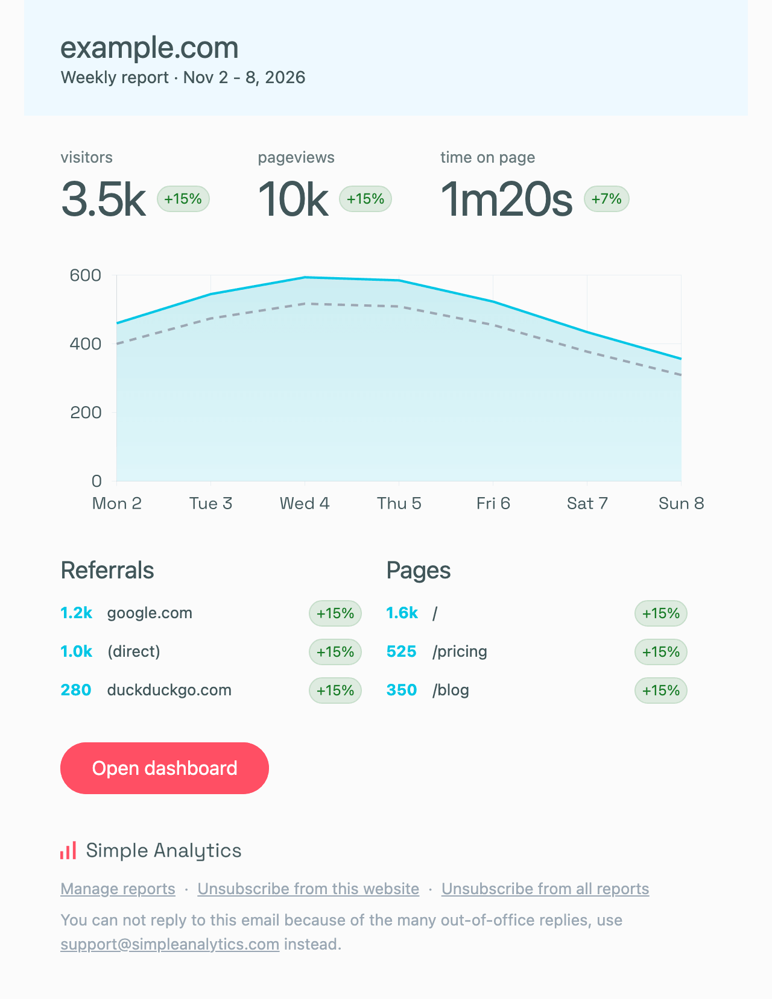
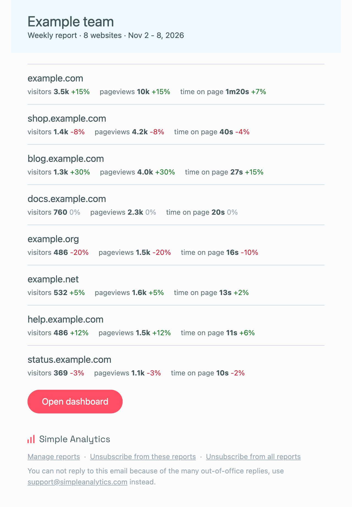
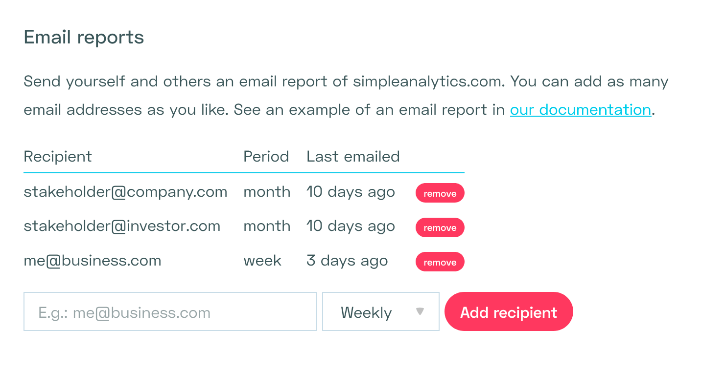

Want to start your Monday morning by checking how your website is doing? Want to keep others up to date? Weekly or monthly email reports bring your most important numbers to your inbox, so you don't have to open the dashboard. Never miss that spike of traffic.

Monthly email reports are enabled by default for new websites. We also enabled them for eligible members of existing teams. Every report has links at the bottom to [turn it off](#unsubscribe).

## What's in a report

A report looks like your dashboard and shows:

- **Visitors, pageviews and time on page** with the change compared to the previous week or month. These are the same numbers your dashboard shows for that period.
- **A chart of visitors per day.** The dashed line shows the previous period.
- **The top 5 referrals and pages** with their changes. A referral or page marked **new** had no visits in the previous period. Pages are left out when **Hide top pages** is on in your website settings.

Click the website name, the chart or **Open dashboard** to see the same period in your dashboard. Click a referral or page to see the dashboard filtered on it.

A weekly report covers Monday to Sunday and a monthly report the whole month, in the time zone of your website. We leave out websites without visitors in that period, so you don't get empty reports.

Some reports end with a short list of what we built that week or month. You can't reply to a report, so email [support@simpleanalytics.com](mailto:support@simpleanalytics.com) with questions or ideas.

## Several websites in one email

When you get reports for more than one website, they arrive in one email, with the websites with the most visitors first. Up to 3 websites get the full report from above. With more websites, each website gets one row with its visitors, pageviews and time on page:

Weekly and monthly reports come in separate emails. If you're in more than one team, you get one email per team.

## When reports arrive

We send weekly reports on Monday and monthly reports on the first day of the month, at 9AM in the time zone of your website. You can change the time zone in your [website settings](https://simpleanalytics.com/select-website/settings#timezone). When one email has websites in different time zones, we send it once it's 9AM for all of them.

After you add a recipient, their first report arrives at the start of the next week or month.

## Add recipients

You can ask your AI app to add a report, for example _"Send me a weekly report of example.com"_. See [Connect AI apps with MCP](/mcp). AI apps can only add reports for people who have access to the website in Simple Analytics.

You can also add a report in [your website settings](https://simpleanalytics.com/select-website/settings#email-reports). Enter an email address, choose **Weekly** or **Monthly** and click **Add recipient**:

You can add people who don't use Simple Analytics too. We email them to say who added them. Your plan sets how many email reports you can add.

To stop the reports for one recipient, click **remove** next to them. Admins can remove every report, [developers and analysts](/explained/team-roles) only the reports they added.

## Unsubscribe

Every report has these links at the bottom:

- **Manage reports** opens the email report settings of the website. In an email with several websites, it opens your list of websites.
- **Unsubscribe from this website** stops the reports of that website for your email address. In an email with several websites, this link is **Unsubscribe from these reports** and stops the reports of all websites in the team at the top of the email.
- **Unsubscribe from all reports** stops all reports to your email address, for every website. Nobody can add your email address again.

The unsubscribe button that some email apps show next to the sender works like the second link.

Unsubscribed by mistake? The page that confirms your unsubscribe has a link to subscribe again. If that link isn't there, [contact us](https://simpleanalytics.com/contact).

When a recipient unsubscribes, you can't add them to the reports of that website again. Only they can subscribe again.
